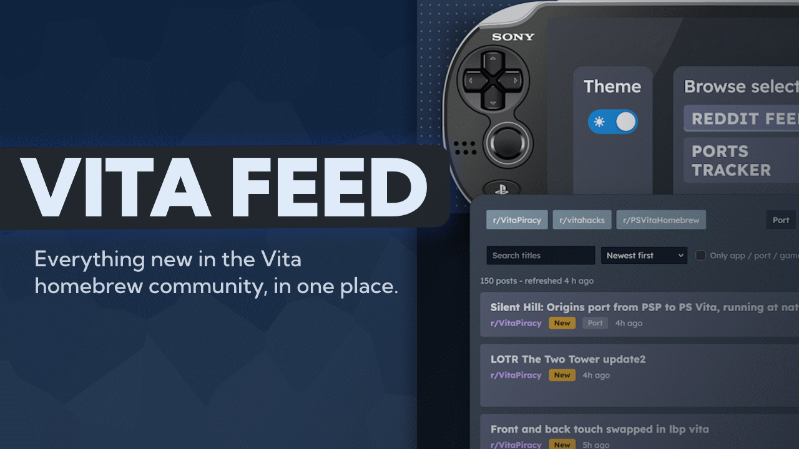

<p align="center">
  <a href="https://rodrickhmmm.github.io/vita-feed/">
    
  </a>
</p>

<p align="center">
  <a href="https://rodrickhmmm.github.io/vita-feed/"><b>Open the live site</b></a>
</p>

Vita Feed collects the latest PS Vita homebrew news in one place. It pulls recent posts from three subreddits, adds a searchable view of the community's Ports Tracker spreadsheet, and presents both in a page styled like a PS Vita screen.

> [!WARNING]
> This project was vibecoded, which I am not proud of. However, the design and overall creative direction were made by me.

## Features

**Reddit feed**
- New posts from [r/VitaPiracy](https://www.reddit.com/r/VitaPiracy), [r/vitahacks](https://www.reddit.com/r/vitahacks) and [r/PSVitaHomebrew](https://www.reddit.com/r/PSVitaHomebrew), newest first.
- Toggle individual subreddits on and off.
- Topic filters (Port, Homebrew, Game, App) matched against post titles and flairs.
- Title search, plus sorting by newest, top score or most comments.
- An "Only app / port / game posts" switch to cut out discussion and questions.
- A "New" badge on posts less than six hours old.

**Ports tracker**
- Live search of the community-maintained *PS Vita Ports Tracker [Official]* Google Sheet.
- Filter by original platform, development stage and playability status, and sort by name or most recently verified.
- Direct links to the developer's project page (GitHub releases, itch.io, VitaDB, GameBrew), the gameplay proof and the original sheet row. Links to file-hosting sites are deliberately skipped.
- Falls back to an embedded copy of the full sheet if the sheet can't be read.

**General**
- Dark and light theme, remembered between visits.
- Works on mobile.
- Links to a view directly with `#feed` or `#tracker`.

## How it works

Vita Feed is a static site with no build step and no backend. It is hosted on GitHub Pages.

```
GitHub Action (scheduled)  ->  posts.json  ->  browser
                                                 |
                               Reddit / public relays (only if the file is stale)
```

1. **A scheduled GitHub Action** (`.github/workflows/update-feed.yml`) fetches the newest posts from the three subreddits, merges them with the existing data, and commits the result to `posts.json`.
   - It is set to run every 20 minutes, but GitHub treats scheduled workflows as best-effort. In practice runs are often delayed or skipped, so expect the file to update every few hours rather than every 20 minutes.
   - It tries one combined request first, then fetches any missing subreddit on its own.
   - If Reddit's JSON endpoint fails it falls back to `old.reddit.com` and then to the RSS feeds.
   - If a subreddit can't be fetched at all, the previous posts for it are kept rather than dropped.
   - The commit only happens when something actually changed.
2. **The page loads `posts.json` first**, so the feed appears right away from the same origin, with no browser blocking. The status line shows how old the data is.
3. **If the file is more than an hour old or a subreddit is missing**, the page tops it up from Reddit in the background, directly or through public CORS relays. It keeps a copy in `localStorage` as a last resort and refreshes itself every 5 minutes.
4. **The Ports tracker** reads the Google Sheet directly from the browser. The sheet has to stay shared as viewable by link.

## Known limitations

- **Update frequency.** See above. The scheduled job runs less often than its 20-minute setting suggests.
- **Scores and comment counts.** Reddit often blocks its JSON endpoints for GitHub's servers, so the updater usually falls back to RSS, which has no score or comment data. In that case the "Top score" and "Most comments" sorts have little to sort on.
- **Third-party dependencies.** The feed relies on Reddit and Google Sheets staying available and on the sheet staying public. If either changes, parts of the site may stop working.

## Running it locally

There's nothing to install. Serve the folder with any static file server:

```bash
git clone https://github.com/rodrickhmmm/vita-feed.git
cd vita-feed
python -m http.server 8000
```

Then open <http://localhost:8000>. Opening `index.html` straight from disk also works, but some data sources may be blocked by the browser.

To refresh `posts.json` yourself, run the workflow manually from the **Actions** tab (*Update Vita feed* -> *Run workflow*). The script lives inline in the workflow file and needs Node 20.

## Contributing

Bug reports, ideas and pull requests are welcome. Open an [issue](https://github.com/rodrickhmmm/vita-feed/issues) to start a discussion. Since there's no build step, changes can be tested by serving the folder as shown above.

## Credits

- Posts belong to their authors and to the subreddits they were posted in. Every entry links back to the original Reddit thread.
- Ports data comes from the community-maintained PS Vita Ports Tracker spreadsheet.
- This project is not affiliated with or endorsed by Sony, Reddit or the Vita homebrew projects it links to.
